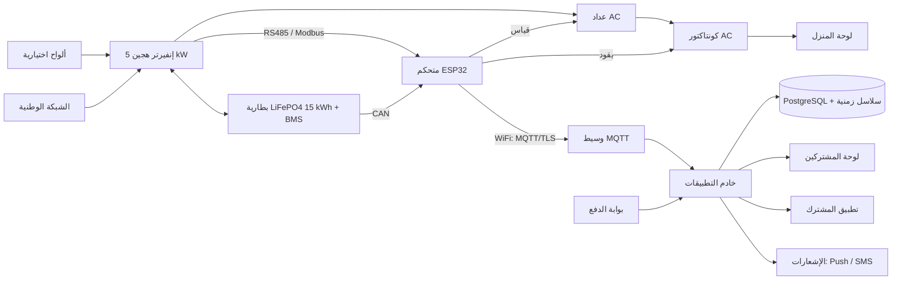

# 02 — المعمارية العامة

## 1. نظرة شاملة

## 2. الطبقات

| الطبقة | المسؤولية |
|---|---|
| **العتاد** | إنفيرتر وبطارية وعداد وكونتاكتور (الجهد العالي والحماية) |
| **المتحكم المحلي** | قرارات الحماية والحد والقطع، يعمل بدون إنترنت |
| **الاتصال** | MQTT على TLS مع شهادة لكل جهاز |
| **السحابة** | سجل المشتركين والأصول، والاشتراكات، والمدفوعات، والإشعارات، والتحليلات |
| **الواجهات** | لوحة المشغل وتطبيق المشترك |

## 3. مبدأ التصميم الأساسي
**القرار اللحظي محلي، والسحابة سياسة وسجل.** السحابة تحدد *ما يجوز* (صلاحية، حد، رمز موقّع)، والجهاز ينفّذ ويحمي نفسه ولا ينتظر السحابة في قرارات السلامة.

## 4. قرارات التصميم

| القرار | الاختيار | السبب |
|---|---|---|
| الإنفيرتر | هجين جاهز يدعم Modbus | تصنيع 350 وحدة لا يبرر تطوير إنفيرتر؛ نبني المتحكم فقط |
| نقطة القطع | كونتاكتور AC على خرج الإنفيرتر | يقطع مسار الـBypass أيضاً، وأسلم من قطع DC تحت الحمل |
| الاتصال | WiFi أولاً، 4G خياراً | أبسط وأرخص، ويُعالج ضعفه برمز صلاحية موقّع |
| البروتوكول | MQTT على TLS | خفيف وثنائي الاتجاه ويتحمل الانقطاع |
| السحابة | وسيط MQTT ذاتي الإدارة على VPS | تكلفة الرسائل في الخدمات المُدارة ترتفع بسرعة عند 3500 جهاز (انظر الوثيقة 05) |
| قاعدة البيانات | PostgreSQL مع امتداد للسلاسل الزمنية | علاقات وقياسات في نظام واحد |
| الكشف عن السرقة | قياسان مستقلان (إنفيرتر وBMS) مع موازنة الطاقة | لا يحتاج عتاداً إضافياً في الإصدار الأول |
| التحديث | OTA موقّع بتقسيمين مع Rollback | ترقيع الأخطاء دون زيارة ميدانية |

## 5. حدود النطاق
- لا تغذية عكسية للشبكة الوطنية (Zero Export).
- لا فوترة حسب الاستهلاك في الإصدار الأول.
- لا دعم لعدة مواقع للمشترك الواحد في الإصدار الأول.
