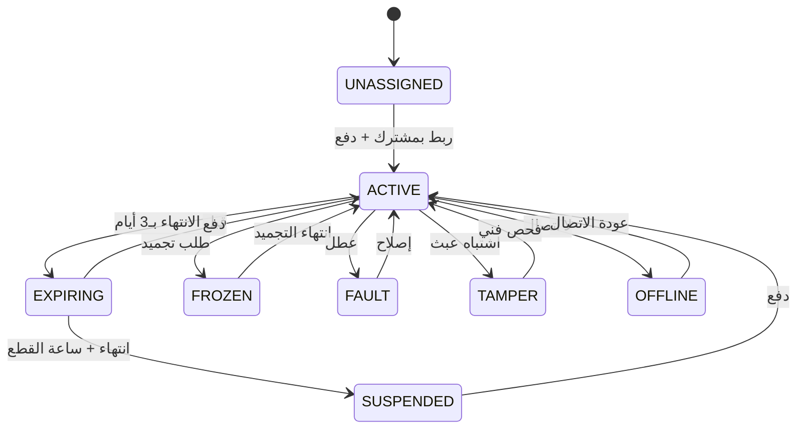

# 04 — منطق التحكم والبرمجيات الثابتة

> القيم أدناه مقترحة وقابلة للمعايرة في التجربة الأولية.

## 1. بنية البرنامج الثابت

| الطبقة | الدور |
|---|---|
| **HAL والمشغلات** | Modbus، وCAN، والعداد، والريلاي، والحساسات |
| **مشرف السلامة** | حماية حرارية وتيارية وفولتية، مستقل عن الشبكة، وله الأولوية دائماً |
| **محرك السياسات** | حد التيار، وصلاحية الاشتراك، وشرائح الشحنة |
| **كشف السرقة** | موازنات القياسات |
| **الاتصال** | MQTT، والتخزين المؤقت عند الانقطاع، وتحديث OTA |

مشرف السلامة يعمل حتى لو تعطل الاتصال أو محرك السياسات.

## 2. حالات الاشتراك (على الخادم)



| الحالة | لون اللوحة |
|---|---|
| ACTIVE | أخضر |
| EXPIRING | برتقالي |
| SUSPENDED / FAULT / TAMPER | أحمر (مع سبب مستقل) |
| OFFLINE | رمادي |
| FROZEN | أزرق فاتح (مقترح) |
| UNASSIGNED | رمادي فاتح |

## 3. حدّ التيار (سلوك مألوف كقاطع المولدة)

منحنى زمني عكسي (قيم أولية):

| الحمل نسبة إلى الحد | مدة التحمل قبل القطع |
|---|---|
| ≤ 100% | غير محدود |
| 100% إلى 110% | نحو 60 ثانية |
| 110% إلى 150% | نحو 10 ثوانٍ |
| > 150% | نحو 3 ثوانٍ (يتحمل بدء المحركات) |

- إعادة الوصل تلقائياً بعد نحو 120 ثانية.
- 3 قطوعات في 30 دقيقة تعني قفلاً 15 دقيقة وتنبيهاً للمشترك.
- كل قطع يُسجل حدثاً.

## 4. شرائح الشحنة (SOC)

| المستوى | الإجراء |
|---|---|
| 40% | إشعار «قلل الاستهلاك» + صفارة قصيرة |
| 20% | تحذير ثانٍ ملحّ |
| 10% | قطع محمي لحماية البطارية |
| العودة | عند عودة الوطنية وبلوغ ≥ 20% |

الصفارة وLED تعمل محلياً لأن الإنترنت قد ينقطع مع الكهرباء.

## 5. رمز الصلاحية الموقّع (العمل بدون إنترنت)

يرسل الخادم رمزاً موقّعاً (مثلاً Ed25519) يحوي:

```
{ device_id, valid_until, limit_A, seq, issued_at }
```

- يحفظ الجهاز المفتاح العام للتحقق.
- يعمل الجهاز حتى `valid_until` حتى لو انقطع الإنترنت.
- `seq` متزايد لمنع إعادة تشغيل رمز قديم (Replay).
- مهلة قصوى لانقطاع الاتصال بالخادم (مقترحة 7 أيام) يُوسم بعدها الجهاز OFFLINE ويُعالج حسب سياسة يحددها المشغل.
- RTC مع عداد أحادي الاتجاه يكشف تلاعب الساعة.

## 6. كشف السرقة والتلاعب

| الفحص | المبدأ | العتبة المقترحة |
|---|---|---|
| **A. تطابق التيار** | تيار البطارية من الإنفيرتر مقابل تيار الـBMS | فرق > max(3 A، 5%) لأكثر من 60 ث |
| **B. موازنة الطاقة** | تغير SOC × السعة × SOH مقابل ∫V·I | انحراف > حد مُعايَر خلال نافذة ساعات |
| **C. كفاءة AC/DC** | قدرة AC الخارجة إلى قدرة DC الداخلة | خارج نطاق 0.85 إلى 0.97 عند حمل > 200 W |
| **D. مفتاح العبث** | فتح الصندوق | فوري |
| **E. غياب طويل** | انقطاع الاتصال بالخادم | حسب مهلة الفقرة 5 |

نتيجة الفحص تولّد حدث TAMPER مع الدليل، وتنتظر فحص فني قبل العودة إلى ACTIVE.

## 7. التحديث عن بُعد (OTA)
- تقسيمان للذاكرة مع Rollback تلقائي عند فشل الإقلاع.
- صورة موقّعة وتحقق قبل التثبيت.
- لا يُحدَّث أثناء حمل عالٍ أو انقطاع وطنية.
- نشر تدريجي (قناة تجريبية ثم عامة).

## 8. سلوك التشغيل عند الأعطال

| العطل | السلوك |
|---|---|
| فقد الاتصال بالإنفيرتر | استمرار بإعدادات آمنة وإشعار |
| فقد الاتصال بالـBMS | قطع شحن/تفريغ محمي حسب القدرة وإنذار |
| حرارة عالية | تخفيض ثم قطع الشحن |
| تعطل المتحكم | إعادة تشغيل بالـWatchdog؛ الإنفيرتر يبقى بحماياته الذاتية |
