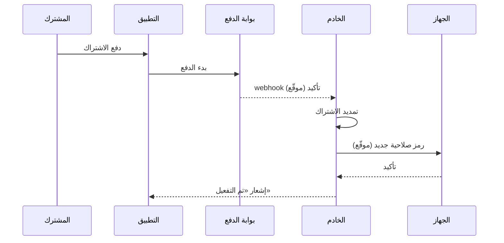

# 05 — السحابة وواجهات البرمجة

## 1. المكوّنات

| المكوّن | الخيار المقترح |
|---|---|
| وسيط MQTT | EMQX (أو Mosquitto المدعوم بـTLS وACL) على VPS |
| قاعدة البيانات | PostgreSQL + امتداد للسلاسل الزمنية |
| الخادم | خدمة API (REST) وخدمة معالجة الأحداث |
| الإشعارات | Push (FCM/APNs) مع SMS احتياطياً |
| لوحة المشغل | تطبيق ويب |
| تطبيق المشترك | تطبيق جوال صغير |

## 2. لماذا وسيط ذاتي الإدارة وليس خدمة IoT مُدارة
عند 3500 جهاز يرسل كل 10 ثوانٍ نحصل نحو 900 مليون رسالة شهرياً، وهذا في الخدمات المُدارة (التسعير بالمليون رسالة) يعني تكلفة شهرية بمئات الدولارات فقط للرسائل. بتخفيض الإرسال إلى مرة كل 60 ثانية يصبح الحجم نحو 150 مليوناً، وبالوسيط الذاتي يبقى ضمن تكلفة VPS صغير. **أرقام التسعير تُراجع من صفحات المزوّد الحالية قبل القرار.**

## 3. تصميم مواضيع MQTT

```
hg/v1/{device_id}/telemetry     ← الجهاز (كل 60 ث، QoS 0/1)
hg/v1/{device_id}/events        ← الجهاز (فوري، QoS 1)
hg/v1/{device_id}/state         ← الجهاز (retained: آخر حالة)
hg/v1/{device_id}/cmd           → الخادم (أوامر موقّعة، QoS 1)
hg/v1/{device_id}/cmd/ack       ← الجهاز (تأكيد)
hg/v1/{device_id}/token         → الخادم (رمز الصلاحية)
```

عينة قياس:
```json
{
  "ts": 1767000000,
  "soc": 72.5,
  "batt_v": 52.1,
  "batt_i": -18.4,
  "bms_i": -18.1,
  "ac_out_w": 1180,
  "ac_out_a": 5.4,
  "grid": true,
  "temp_c": 36.2,
  "limit_a": 10,
  "fw": "0.1.0"
}
```

عينة حدث:
```json
{ "ts": 1767000300, "type": "OVERLOAD_TRIP", "i_a": 17.3, "limit_a": 10 }
```

عند فقد الاتصال يخزن الجهاز القياسات محلياً ويرسلها مجمّعة (Batching) عند العودة.

## 4. نموذج البيانات (مبسّط)

| الجدول | الأعمدة الرئيسية |
|---|---|
| `devices` | id، serial، fw، حالة، تاريخ التصنيع/الضمان |
| `subscribers` | id، الاسم، الهاتف، العنوان |
| `assignments` | device_id، subscriber_id، من، إلى |
| `plans` | id، حد التيار، سعر الصيف/الشتاء |
| `subscriptions` | id، assignment_id، plan_id، من، إلى، حالة، تجميد |
| `payments` | id، subscription_id، المبلغ، الحالة، مرجع البوابة |
| `telemetry` | device_id، ts، قياسات (جدول سلاسل زمنية) |
| `events` | device_id، ts، نوع، حمولة |
| `commands` | device_id، ts، نوع، حالة التأكيد |
| `health` | device_id، SOH، دورات، أقصى حرارة، kWh الإجمالية |

الفصل بين `devices` و`subscribers` عبر `assignments` يسمح بنقل الوحدة بين المشتركين دون المساس بتاريخها.

## 5. واجهات REST (نظرة)

| المسار | الوظيفة |
|---|---|
| `GET /subscribers` | قائمة المشتركين مع الحالة واللون |
| `GET /subscribers/{id}` | تفاصيل، واستهلاك، وقراءات |
| `POST /subscribers/{id}/freeze` | طلب تجميد |
| `POST /devices/{id}/assign` | ربط وحدة بمشترك |
| `POST /devices/{id}/command` | أمر (قطع/وصل/تغيير حد) |
| `POST /payments/webhook` | استقبال تأكيد من بوابة الدفع (مع توقيع وعدم التكرار) |
| `GET /devices/{id}/health` | صحة الأصل |
| `GET /reports/charge-sufficiency` | مؤشر كفاية الشحن |

## 6. سير الدفع والتفعيل



- كل webhook مفتاحه مرجع فريد لمنع الاحتساب المزدوج (Idempotency).
- يُحدّث الجهاز بالرمز حتى لو فشل الإشعار.

## 7. الإشعارات
- قبل الانتهاء بـ3 أيام، وقبل يوم، وصباح الانتهاء.
- انخفاض الشحنة (40% و20%)، وحمل زائد، وانقطاع مفاجئ، وعطل.
- SMS احتياطي عند فشل Push.
